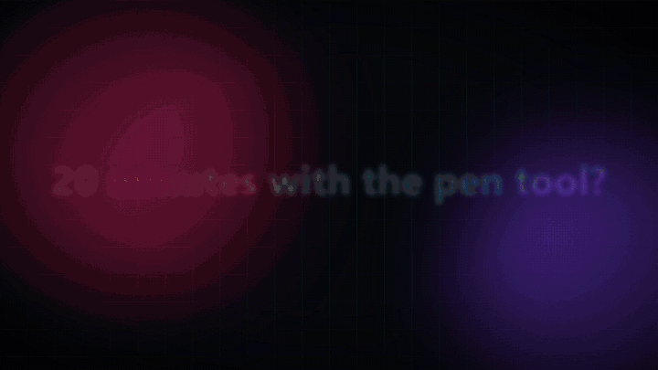

<p align="center"></p>

<h1 align="center">pedit — open-source AI image editor you can drive with words (MCP)</h1>

<p align="center">
  <strong>A free, layered photo editor — a Photoshop / GIMP alternative — that an AI agent can use for you.</strong><br/>
  Layers, groups, masks, clipping masks, 27 blend modes, adjustment layers, clone stamp and healing brush,
  plus generative fill, generative expand, image-to-image, text-to-image, background removal and upscaling —
  locally or with your own OpenAI, Gemini, Stability AI, Replicate or OpenRouter API key.
</p>

<p align="center">
  
  
  
  
</p>

<p align="center"></p>

You say what you want in plain words — *"remove the background, extend the sky, make it warmer"* — and
it works on real layers while you watch. Grab the mouse and fix anything at any point. Works with
**Claude Code, Cursor, Codex, VS Code** and any [Model Context Protocol](https://modelcontextprotocol.io) client.

> 🇮🇹 Italiano: [README.it.md](README.it.md) · Sister project for video: [editorvideo-ai (vedit)](https://github.com/metiutek/editorvideo-ai)

## Install — 3 steps

**1. Install uv** (it installs Python apps for you), then close and reopen the terminal.

| Windows (PowerShell) | macOS | Linux |
|---|---|---|
| `winget install astral-sh.uv` | `brew install uv` | `curl -LsSf https://astral.sh/uv/install.sh \| sh` |

**2. Install pedit**

```bash
uv tool install "pedit-mcp[ai]"
```

`[ai]` adds local background removal and object removal.

**3. Open the editor**

```bash
pedit ui
```

The editor opens at <http://127.0.0.1:8770>. **Optional — let Claude Code edit for you:**
`claude mcp add pedit -- pedit-mcp`. Something wrong? `pedit doctor` says what is missing.

---

## What it is

pedit is an image editor of the ordinary kind: a canvas, a stack of layers, masks, blend
modes, adjustment layers, filters, layer styles, a brush, text and shapes.

The difference is that **everything you can do with the mouse, an AI can also do on command** —
the buttons, the built-in assistant and any MCP agent call the exact same operations. Nothing is
AI-only, nothing is mouse-only. So instead of twenty minutes with the pen tool you type:

> *"Remove the background, put her on a soft blue gradient, warm it up a little, and add the
> title at the bottom with a subtle shadow."*

and the layers appear in the panel, one by one. Wrong shadow? Click the layer and drag the slider.

**Nothing is destructive.** A filter is an entry in the layer's effects, a look is an adjustment
layer, the AI cut-out is a *mask*, an object removal is a *patch on a new layer*. Your photo is
never rewritten, and every step undoes with Ctrl+Z.

## What makes it work

| | |
|---|---|
| **An agent can actually edit** | 62 MCP tools that are the *same* operations as the buttons: layers and groups, clipping masks, painted masks, transforms, 33 filters and styles, 27 blend modes, looks, clone stamp, crop, resize, AI tools, export. |
| **The agent sees what it did** | `preview` returns the real rendered image (with an optional coordinate grid, or zoomed on a box). `analyze_image` measures exposure, clipping, colour cast and sharpness, so corrections are measured, not guessed. |
| **It checks its own work** | `review_image` flags text cut by the edge or unreadable on its background, layers off the canvas, blown highlights, upscaled images — each with the tool that fixes it. |
| **AI locally, or online with your key** | Background removal (rembg/ONNX), object removal and spot healing (OpenCV, or a numpy fallback), and — with [ComfyUI](https://github.com/comfyanonymous/ComfyUI) or an online service — text-to-image, image-to-image, generative fill, generative expand and model upscaling. Online services with your own API key: OpenAI (GPT Image), Google Gemini (Nano Banana), Stability AI, OpenRouter, Replicate (FLUX…), any OpenAI-compatible endpoint; image-to-text with Gemini, OpenAI, Claude or a local Ollama vision model. |
| **Same document, same pixels** | The document is a JSON file and the render is a pure function of it: the preview, what the agent sees and the exported file come out of the same code. |

## Driving it from an agent (MCP)

The running editor **is** an MCP server at `http://127.0.0.1:8770/mcp/`. An agent connected
there works on the document open in your browser, live:

```bash
claude mcp add --transport http pedit-live http://127.0.0.1:8770/mcp/
```

Or the classic stdio server, for agents that start without a UI (`open_ui` opens the editor on
the agent's document later):

```bash
claude mcp add pedit -- uvx pedit-mcp
```

Same JSON for Cursor, Codex, VS Code: `{ "mcpServers": { "pedit": { "command": "pedit-mcp" } } }`.

Typical flow:

```
project_create / project_open(photo) → add_image / add_text / add_shape / add_fill
  → analyze_image → auto_enhance or add_adjustment → apply_look
  → remove_background / set_mask / mask_stroke / inpaint / edit_image / expand_canvas
  → preview (look!) → review_image → export_image
```

`batch` applies a list of edits in one atomic call with one undo step, and `batch(look=true)`
returns the preview in the same round trip. The editing rules (look before claiming done,
measure before correcting, base before style, stay non-destructive, never export unasked) ship
inside the server instructions, so every client gets them.

## The web interface

```
┌──────────────────────────────────────────────────────────────────────┐
│ New · Open · Save · ↶↷ · Import · Generate · Auto enhance · AI models│
│ tool options (brush size, text, selection actions…)                  │
├────┬──────────────────────────────────────────┬──────────────────────┤
│ ✥  │                                          │ Layers | Looks | AI  │
│ ⬚  │              canvas                      │  layer stack         │
│ ◯  │      (server-rendered, exact)            │  properties, mask,   │
│ ✂  │                                          │  effects, AI buttons │
│ ✎  │                                          │                      │
└────┴──────────────────────────────────────────┴──────────────────────┘
```

- **Tools:** move/resize (V), rectangle (M) and ellipse (L) selection, crop (C), brush (B),
  eraser (E), clone stamp (S, Alt+click the source, *Heal* for the healing brush), spot healing
  brush (J), text (T), shapes (U), pan (H). Brush and eraser can paint on a layer's mask (hide /
  reveal), also to refine an AI cut-out. With a selection: *mask layer*, *remove object*,
  *generative fill*, *edit area with AI*, *describe*, *crop to selection*.
- **Layers:** groups (pass-through or isolated, with their own opacity, blend, mask and effects),
  clipping masks, visibility, lock, rename (double click), drag to reorder or into a group,
  duplicate, merge down, opacity and all 27 Photoshop blend modes. Image, text, shape,
  fill/gradient, paint, adjustment and group layers.
- **AI:** generate, generative fill, edit with AI (image-to-image, with strength), expand canvas,
  describe (image-to-text), upscale, remove background — each lets you pick local or an online
  model. *AI models* holds the API keys (on this computer only, `~/.pedit/ai_api.json`) and which
  model does what; *Auto* uses an online service only if you made it the default.
- **Looks:** cinematic, black & white, warm, cool, faded film, vivid, matte, vintage, dramatic,
  clean portrait — each one an editable chain of filters.
- **Assistant:** Claude Code (your subscription, no key), Anthropic with a key, or any
  OpenAI-compatible service (OpenAI, Gemini, OpenRouter, Ollama, LM Studio…). Point at an area
  (`+ area`) or a layer (`+ layer`) and refer to it in words. Exports always ask you first.
- Drop images on the window to import them. Ctrl+Z/Y, Ctrl+S, Ctrl+J duplicate, Del delete,
  0 fit, 1 = 100%, Ctrl+wheel zoom.

## Command line

```bash
pedit new poster.json --preset instagram_post
pedit add poster.json photo.jpg --fit cover
pedit text poster.json "SUMMER SALE" --size 140 --bold --align center-bottom
pedit enhance poster.json
pedit look poster.json warm
pedit cutout poster.json <layer-id>          # needs the ai extra
pedit export poster.json poster.jpg --quality 90
pedit review poster.json
pedit effects -v | pedit looks | pedit doctor | pedit ui
```

## Optional extras

| Extra | What it adds |
|---|---|
| `ai` | `rembg` + `onnxruntime` (background removal, models downloaded on first use) and OpenCV (better object removal) |
| `chat` | `anthropic` — the assistant with an Anthropic API key (other engines need nothing) |
| ComfyUI | not a pip package: run it locally (default `127.0.0.1:8188`) and `generate_image`, `edit_image`, `inpaint(prompt=…)`, `expand_canvas` and model `upscale` light up. `comfy_settings` picks the URL, checkpoint and upscaler. |
| Online models | no package either: paste an API key in *AI models* (or set `OPENAI_API_KEY`, `GEMINI_API_KEY`, `STABILITY_API_KEY`, `OPENROUTER_API_KEY`, `REPLICATE_API_TOKEN`, `ANTHROPIC_API_KEY`) and pass `backend=<service>` — or make one the default for `auto`. |

## FAQ

**Is pedit a free alternative to Photoshop or GIMP?**
It is a free, MIT-licensed layered raster editor with the core of both: layers and layer groups,
masks, clipping masks, adjustment layers, 27 blend modes, filters, layer styles, brush, clone stamp,
healing brush, text and shapes. It does not try to replace every feature (no CMYK, no 16-bit, no PSD
yet); its focus is non-destructive editing that both you and an AI agent can drive.

**Can I use generative fill and AI image generation without a GPU?**
Yes. Paste an API key for OpenAI (GPT Image), Google Gemini (Nano Banana), Stability AI, Replicate
(FLUX) or OpenRouter in *AI models*. With a GPU you can run everything locally through ComfyUI. Object
removal, spot healing and background removal also work offline on the CPU.

**Does it describe images (image-to-text)?**
Yes: `describe_image` / *Describe* uses a vision model — Gemini, OpenAI, Claude, OpenRouter or a local
Ollama model — to caption a picture, a layer or an area, or to answer a question about it.

**Which AI agents can edit images with pedit?**
Any MCP client: Claude Code, Claude Desktop, Cursor, OpenAI Codex, VS Code, and the built-in assistant
(Claude, OpenAI, Gemini, OpenRouter, Ollama, LM Studio). The agent gets 62 tools and sees the real
rendered result with `preview`.

**Is my API key safe?**
Keys stay on your computer in `~/.pedit/ai_api.json` (or environment variables). They are never written
into documents and never passed through the MCP tools.

## How it works

```
backend/pedit/
  model.py      document (dataclass ↔ JSON): layers, masks, effects, assets
  effects.py    filter and layer-style registry: params, validation, numpy kernels
  render.py     document → pixels (W3C blend modes, masks, styles), export
  store.py      every edit + undo/redo + atomic save — the only way to change a document
  ai.py         background removal, fill, generation, image-to-image, upscale (with fallbacks)
  cloud.py      online image models with the user's API key (OpenAI, Gemini, Stability, …)
  comfy.py      minimal ComfyUI client (txt2img, inpaint, upscale workflows)
  analyze.py    measurements and document review
  mcp_server.py MCP tools        api.py  REST/WebSocket for the UI
  chat.py/llm.py the in-app assistant (its tools are the MCP tools)
frontend/       React + Vite UI
tests/          pixel-level tests of every effect, blend mode, mask and operation
```

**One source of truth:** the UI, the assistant and the MCP agent all call methods of `Store`.
Add an operation there first, then expose it.

## Tests

```bash
pytest                         # ~180 tests, ~25 s, no network, no models
cd frontend && npm run build && npm test
```

## Development

```bash
git clone https://github.com/metiutek/editorimage-ai && cd editorimage-ai
python scripts/setup.py --venv        # deps, UI build, MCP registration, doctor, tests
```

Code and comments are in Italian (project convention); everything a user reads is in English.
See [AGENTS.md](AGENTS.md) and [CONTRIBUTING.md](CONTRIBUTING.md).

## License

MIT — see [LICENSE](LICENSE).

---

Made by [metiu.xyz](https://metiu.xyz/)
